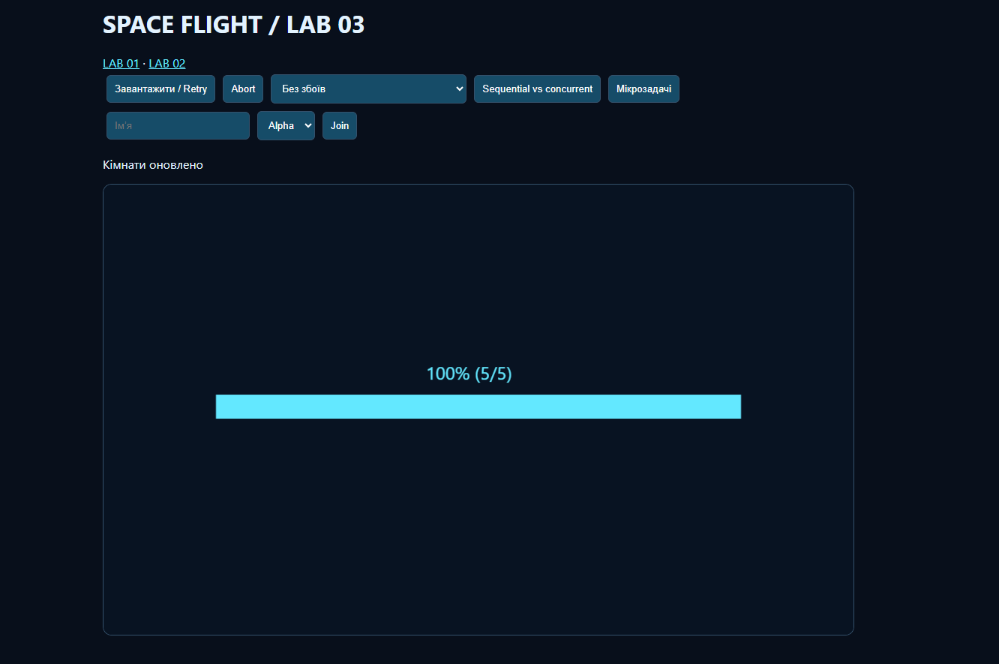
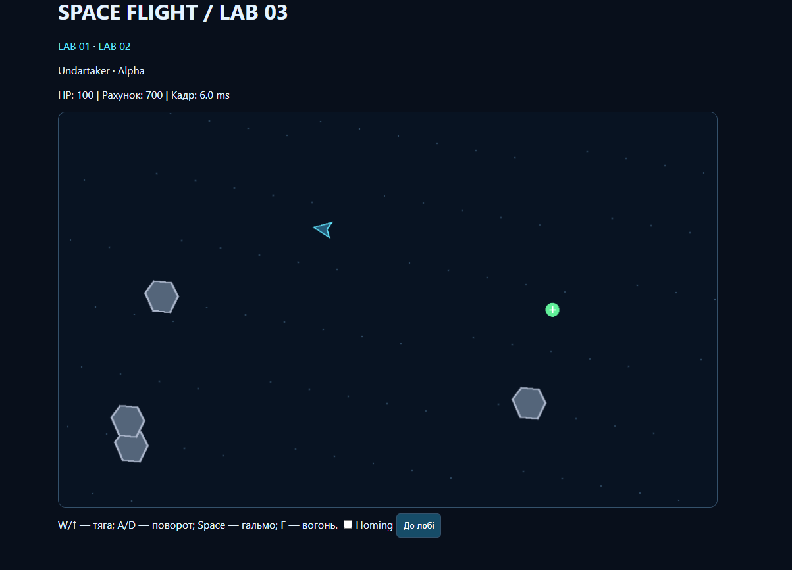
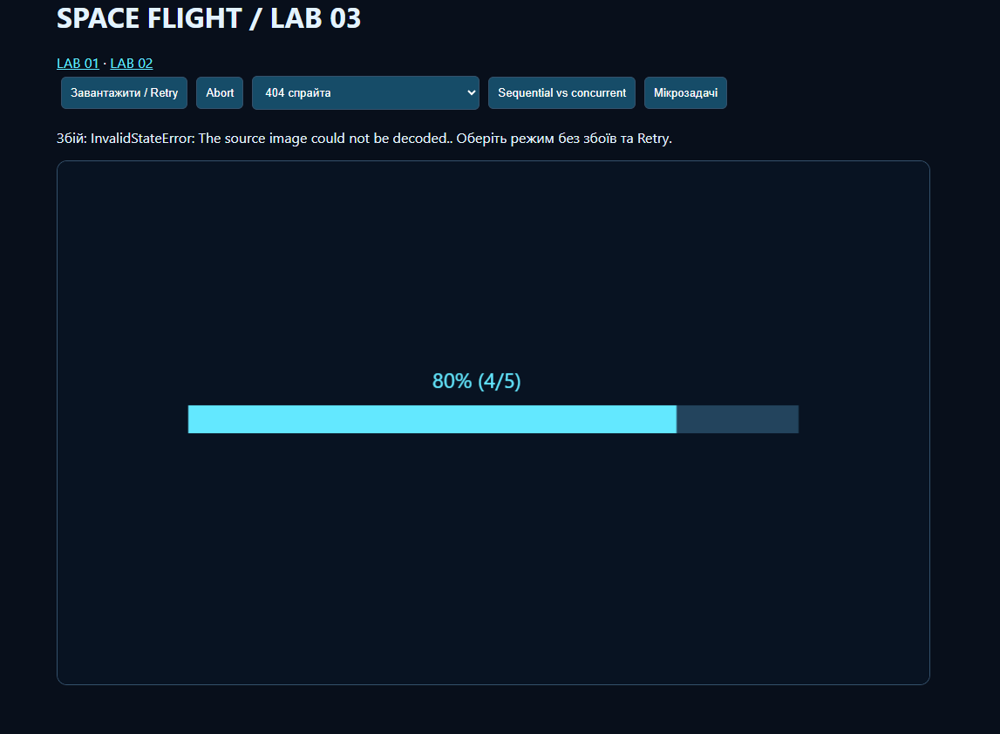
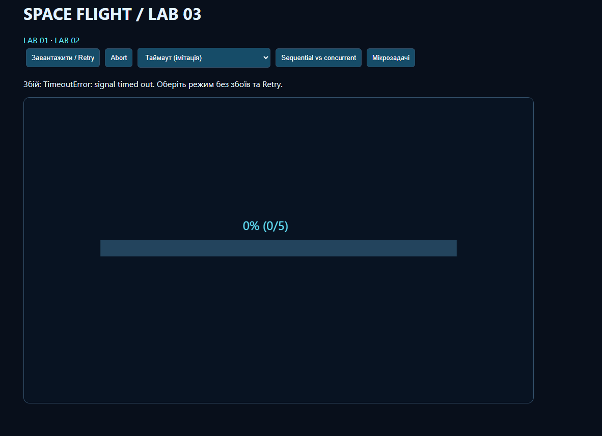
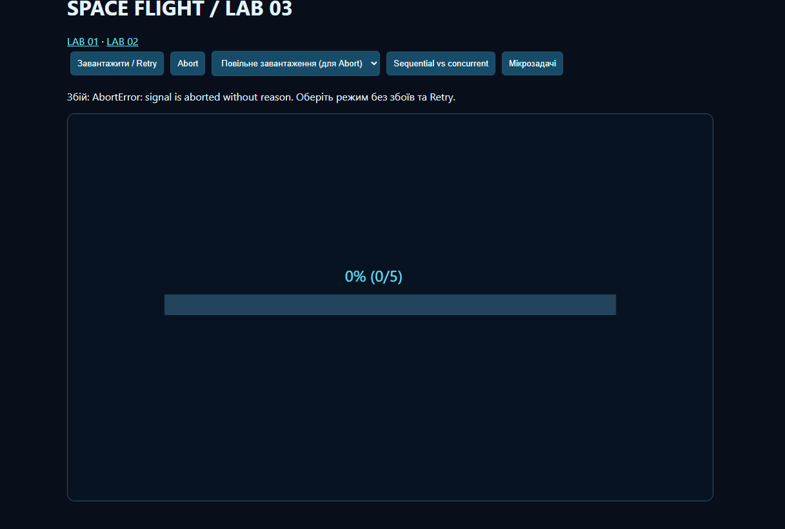
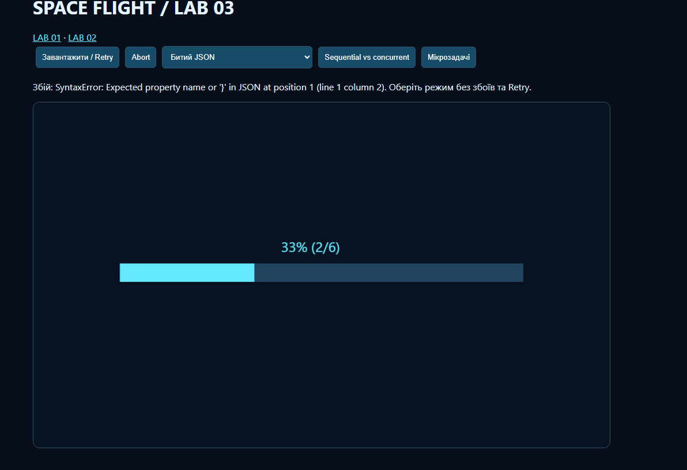
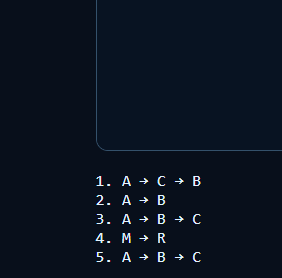
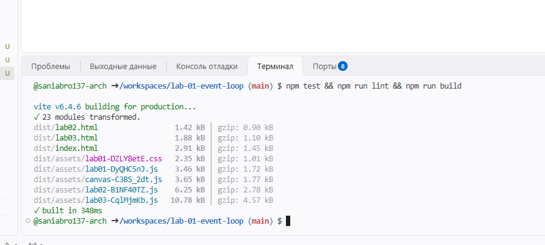

# Space Flight — лабораторна робота №1

**Тема:** Event Loop та Game Loop у JavaScript.

## Мета
Дослідити роботу циклу подій браузера, фіксованого кроку симуляції та інтерполяції рендерингу.

## Реалізація
Проєкт створено на Vite (Vanilla JS). `createLoop()` використовує requestAnimationFrame та акумулятор із кроком 1/60 с. Рендер використовує інтерполяцію попереднього й поточного станів. `createInput()` реалізує обробку клавіатури через замикання, а `integrate(ship, input, dt)` — фізику без залежності від DOM. Canvas враховує devicePixelRatio; координати корабля загортаються на краях арени. HUD показує steps/s, frames/s, час кадру та jitter.

## Запуск

```bash
npm install
npm run dev
```

Керування: W/↑ — тяга; A/D або ←/→ — поворот; Space — гальмо; R — скидання.

## Перевірка

```bash
npm test
npm run lint
npm run build
```

Перевірки виконано успішно в GitHub Codespaces. Збірка Vite 6.4.6 тривала 321 мс.

## Експерименти
Вимірювання проведено 24.11.2026 у браузері Chrome, у відкритій вкладці гри. Усі режими вимірювалися без додаткового навантаження (окрім штатного блокування в експерименті №1).

| Режим | Тривалість, с | Вибірки | Steps/s | FPS | Час кадру, мс | Макс. час кадру (вибірки), мс | Jitter, мс |
|---|---:|---:|---:|---:|---:|---:|---:|
| Норма: rAF + fixed 60 Hz | 10.04 | 10 | 60.04 | 164.92 | 6.07 | 6.20 | 0.20 |
| №1: блокування 100 мс | 10.89 | 11 | 60.01 | 132.99 | 22.58 | 97.00 | 11.63 |
| №2: setInterval(16) | 10.36 | 11 | 59.97 | 62.50 | 16.23 | 17.20 | 0.73 |
| №3: variable dt | 10.06 | 11 | 164.84 | 164.84 | 6.06 | 6.20 | 0.14 |

Час кадру та його максимум наведено за вибірками HUD, а не за повним журналом усіх кадрів; тому середній час кадру не обов'язково дорівнює 1000/FPS.

### Експеримент 1 — блокуючий цикл
Блокування головного потоку на 100 мс затримує обробку подій і можливості рендерингу. FPS знизився на 19.36%, jitter зріс з 0.20 до 11.63 мс. Акумулятор дозволив компенсувати затримки симуляції: 60.01 steps/s.

### Експеримент 2 — setInterval замість rAF
Таймер із затримкою 16 мс планує завдання незалежно від оновлення дисплея. Частота рендерингу становила 62.50 FPS (на 62.10% нижче еталона), а симуляція залишилася близькою до 60 Hz. Таймер не гарантує точного моменту виконання callback, оскільки він залежить від зайнятості Event Loop.

### Експеримент 3 — змінний крок
Фізика оновлюється один раз за кадр зі змінним dt. Отримано 164.84 steps/s та 164.84 FPS. Частота симуляції стала залежною від рендерингу. Змінний dt може впливати на точність чисельного інтегрування; вимірювання без навантаження підтверджує залежність частот, але не доводить величину похибки траєкторії. Додатковий тест під навантаженням не проводився.

## Висновок
Фіксований крок 1/60 с відокремлює частоту фізики від рендерингу. requestAnimationFrame забезпечує узгодження рендерингу з можливостями браузера та дисплея. Блокування головного потоку погіршує плавність, а setInterval обмежує частоту оновлення. Змінний крок прив'язує симуляцію до кадрів. Для гри доцільно використовувати rAF, акумулятор і інтерполяцію.

# Лабораторна 2 — Об’єкти, прототипи та this

Запуск: `npm install`, `npm run dev`, відкрити `/lab02.html`. Лаба 1 залишається на `/`. Керування: W/↑, A/D або стрілки, Space — гальмо, F — стрільба, R — скидання. Homing вмикається прапорцем. Зелені бонуси відновлюють 25 HP, астероїди мають 2 HP, корабель — 100 HP. Знищення астероїда дає 100 очок, бонус — 25. Респаун через 2 секунди симуляції.

## Модель
Vector2 повертає нові вектори. Entity має статичний приватний #id, позицію, швидкість, радіус, kind та update. Ship extends Entity повторно використовує чисту integrate з лаби 1. #hp доступне через get hp(). World зберігає сутності в Map, мертві ID у Set; після update і колізій виконується sweep. ofKind — генератор. Колізії коло-коло перевіряються попарно O(n²), з урахуванням загортання арени. Кулі мають TTL, власника, вилітають з носа; частинки вибуху також мають TTL.

## this і прототипи
У модулі звичайний виклик відокремленого методу `const f = ship.fire; f(world)` має this=undefined, тому виникає TypeError. У слухачі DOM звичайна функція отримує this елемента (а не корабля). Виклик `ship.fire(world)` встановлює this на ship. Явне прив’язування: `ship.fire.call(ship, world)`, `ship.fire.apply(ship, [world])`, `ship.fire.bind(ship, world)`. Виклик через new створює новий об’єкт для функції-конструктора (метод класу fire не є конструктором). Стрілки не мають власного this, успадковують його лексично. У грі використано обгортку-стрілку, яка знаходить актуальний корабель і викликає його метод; це працює після респауну. Для DOM-слухача аналогічний фікс: `button.addEventListener('click', () => ship.fire(world))`; bind також працює, але прив’язує конкретний екземпляр. Кнопка експерименту виконує відокремлений виклик і перевіряє `Object.getPrototypeOf(ship) === Ship.prototype` та `Object.getPrototypeOf(Ship.prototype) === Entity.prototype`; результат виводиться на екран і в консоль. Очікування: TypeError, true, true. Автоматичний тест підтвердив TypeError; браузерний результат ще треба перевірити.

## Дизайн: композиція
Ієрархія Entity → Ship достатня. Якби кожна можливість була підкласом, виникли б Bullet, HomingBullet, TimedHomingBullet, HomingAsteroid тощо; комбінування поведінок породжувало б нові класи. Натомість Entity має масив components, а ttl та homing є функціями поведінки, які можна комбінувати. Homing шукає найближчий астероїд і коригує швидкість; pickup створюється фабрикою звичайної Entity з функцією collect, не успадковує Ship. Це відокремлює поведінку від типу сутності. Недолік — необхідно узгоджувати порядок компонентів і їхні контракти.

## Перевірка
`npm test` — 9 тестів пройшли у Node.js (3 попередні та 6 нових). `npm run lint` і `npm run build` та ручна перевірка гри — виконати у Codespaces перед здачею.

# Лабораторна 3 — Async JavaScript
Запуск: `npm run dev -- --host 0.0.0.0 --port 5176`, сторінка `/lab03.html`. Натиснути «Завантажити», обрати ім’я та кімнату, Join. F — вогонь. Лобі запитує GET /api/rooms кожні 5 с після завершення попереднього запиту, timeout 4 с; при Join запит скасовується. Кімнати визначають кількість астероїдів. Vite middleware працює у dev та preview.

Manifest містить PNG-спрайтшит, три WAV і JSON. Promise.all завантажує паралельно; прогрес відображає завершені файли. HTTP 4xx та синтаксична помилка JSON не повторюються; інші помилки мають до двох повторів з exponential backoff та jitter. AbortSignal передається fetch і перевіряється після декодування. AudioContext активується кнопкою, модель передає fired/hit/exploded через EventTarget, не імпортує звук або DOM.

## Вимірювання
Кнопка Sequential vs concurrent виводить фактичний час у мс. Записати результат після запуску: sequential — ще не виміряно; concurrent — ще не виміряно. Другий прохід може отримати перевагу кешу; для точного порівняння повторити зі вимкненим кешем DevTools.

## П’ять головоломок
Кнопка «Мікрозадачі» виконує приклади з puzzles.js. Очікуваний вивід:
1. A → C → B: синхронний код перед then.
2. A → B: продовження після await є мікрозадачею.
3. A → B → C: setTimeout усередині then планує окрему задачу після мікрозадач.
4. M → R: мікрозадача перед callback requestAnimationFrame.
5. A → B → C: нова мікрозадача додається в кінець черги.
Promise має pending, fulfilled, rejected. then повертає новий Promise; throw перетворюється на rejection. all відхиляється при першій помилці, allSettled збирає всі результати, race повертає перший завершений, any — перший успішний (або AggregateError). for await...of послідовно очікує елементи.

## Галерея збоїв (сценарії для ручної перевірки)
- 404 спрайта: обрати 404, натиснути завантаження; очікується HTTP 404 та Retry без повтору запиту.
- Таймаут: режим timeout імітує повільну операцію з AbortSignal.timeout; очікується TimeoutError.
- Abort: обрати повільне завантаження, натиснути завантаження та Abort до завершення затримки; очікується AbortError.
- Битий JSON: очікується SyntaxError. Після кожного збою обрати «Без збоїв» і Retry.
Фактичні результати та скриншоти браузера ще потрібно отримати.

## Фактичні результати LAB 03

### Порівняння швидкості завантаження

| Метод | Час |
|---|---:|
| Sequential await | 726.50 ms |
| Concurrent Promise.all | 121.60 ms |

Паралельне завантаження показало прискорення
приблизно у 5.97 раза. На результат міг вплинути кеш.

### Результати перевірки збоїв

- 404 спрайта: HTTP 404, прогрес 0% (0/5).
- Таймаут: TimeoutError, прогрес 0%.
- Abort: AbortError, прогрес 0%.
- Битий JSON: SyntaxError, прогрес 33%.
- Retry: успішне відновлення, прогрес 100%.

У всіх сценаріях інтерфейс залишився працездатним.
Після виправлення Vite підтверджено HTTP 404.

### Перевірка проєкту

- npm test — успішно.
- npm run lint — успішно.
- npm run build — успішно.
- Vite: 23 модулі, час збірки 348 мс.

## Галерея результатів LAB 03

### Початковий екран


### Завантаження ресурсів та лобі


### Ігровий процес


### Помилка завантаження спрайта


### Таймаут мережі


### Скасування завантаження


### Битий JSON


### Sequential vs concurrent


### Порядок мікрозадач


### Успішна збірка проєкту

