# Space Flight — лабораторна робота №1

**Тема:** Event Loop та Game Loop у JavaScript.

## Мета
Дослідити роботу циклу подій браузера, фіксованого кроку симуляції та інтерполяції рендерингу.

## Реалізація
Проєкт створено на Vite (Vanilla JS). `createLoop()` використовує requestAnimationFrame та акумулятор із кроком 1/60 с. Рендер використовує інтерполяцію попереднього й поточного станів. `createInput()` реалізує обробку клавіатури через замикання, а `integrate(ship, input, dt)` — фізику без залежності від DOM. Canvas враховує devicePixelRatio; координати корабля загортаються на краях арени. HUD показує steps/s, frames/s, час кадру та jitter.

## Запуск

```bash
npm install
npm run dev
```

Керування: W/↑ — тяга; A/D або ←/→ — поворот; Space — гальмо; R — скидання.

## Перевірка

```bash
npm test
npm run lint
npm run build
```

Перевірки виконано успішно в GitHub Codespaces. Збірка Vite 6.4.6 тривала 321 мс.

## Експерименти
Вимірювання проведено 24.11.2026 у браузері Chrome, у відкритій вкладці гри. Усі режими вимірювалися без додаткового навантаження (окрім штатного блокування в експерименті №1).

| Режим | Тривалість, с | Вибірки | Steps/s | FPS | Час кадру, мс | Макс. час кадру (вибірки), мс | Jitter, мс |
|---|---:|---:|---:|---:|---:|---:|---:|
| Норма: rAF + fixed 60 Hz | 10.04 | 10 | 60.04 | 164.92 | 6.07 | 6.20 | 0.20 |
| №1: блокування 100 мс | 10.89 | 11 | 60.01 | 132.99 | 22.58 | 97.00 | 11.63 |
| №2: setInterval(16) | 10.36 | 11 | 59.97 | 62.50 | 16.23 | 17.20 | 0.73 |
| №3: variable dt | 10.06 | 11 | 164.84 | 164.84 | 6.06 | 6.20 | 0.14 |

Час кадру та його максимум наведено за вибірками HUD, а не за повним журналом усіх кадрів; тому середній час кадру не обов'язково дорівнює 1000/FPS.

### Експеримент 1 — блокуючий цикл
Блокування головного потоку на 100 мс затримує обробку подій і можливості рендерингу. FPS знизився на 19.36%, jitter зріс з 0.20 до 11.63 мс. Акумулятор дозволив компенсувати затримки симуляції: 60.01 steps/s.

### Експеримент 2 — setInterval замість rAF
Таймер із затримкою 16 мс планує завдання незалежно від оновлення дисплея. Частота рендерингу становила 62.50 FPS (на 62.10% нижче еталона), а симуляція залишилася близькою до 60 Hz. Таймер не гарантує точного моменту виконання callback, оскільки він залежить від зайнятості Event Loop.

### Експеримент 3 — змінний крок
Фізика оновлюється один раз за кадр зі змінним dt. Отримано 164.84 steps/s та 164.84 FPS. Частота симуляції стала залежною від рендерингу. Змінний dt може впливати на точність чисельного інтегрування; вимірювання без навантаження підтверджує залежність частот, але не доводить величину похибки траєкторії. Додатковий тест під навантаженням не проводився.

## Висновок
Фіксований крок 1/60 с відокремлює частоту фізики від рендерингу. requestAnimationFrame забезпечує узгодження рендерингу з можливостями браузера та дисплея. Блокування головного потоку погіршує плавність, а setInterval обмежує частоту оновлення. Змінний крок прив'язує симуляцію до кадрів. Для гри доцільно використовувати rAF, акумулятор і інтерполяцію.

# Лабораторна 2 — Об’єкти, прототипи та this

Запуск: `npm install`, `npm run dev`, відкрити `/lab02.html`. Лаба 1 залишається на `/`. Керування: W/↑, A/D або стрілки, Space — гальмо, F — стрільба, R — скидання. Homing вмикається прапорцем. Зелені бонуси відновлюють 25 HP, астероїди мають 2 HP, корабель — 100 HP. Знищення астероїда дає 100 очок, бонус — 25. Респаун через 2 секунди симуляції.

## Модель
Vector2 повертає нові вектори. Entity має статичний приватний #id, позицію, швидкість, радіус, kind та update. Ship extends Entity повторно використовує чисту integrate з лаби 1. #hp доступне через get hp(). World зберігає сутності в Map, мертві ID у Set; після update і колізій виконується sweep. ofKind — генератор. Колізії коло-коло перевіряються попарно O(n²), з урахуванням загортання арени. Кулі мають TTL, власника, вилітають з носа; частинки вибуху також мають TTL.

## this і прототипи
У модулі звичайний виклик відокремленого методу `const f = ship.fire; f(world)` має this=undefined, тому виникає TypeError. У слухачі DOM звичайна функція отримує this елемента (а не корабля). Виклик `ship.fire(world)` встановлює this на ship. Явне прив’язування: `ship.fire.call(ship, world)`, `ship.fire.apply(ship, [world])`, `ship.fire.bind(ship, world)`. Виклик через new створює новий об’єкт для функції-конструктора (метод класу fire не є конструктором). Стрілки не мають власного this, успадковують його лексично. У грі використано обгортку-стрілку, яка знаходить актуальний корабель і викликає його метод; це працює після респауну. Для DOM-слухача аналогічний фікс: `button.addEventListener('click', () => ship.fire(world))`; bind також працює, але прив’язує конкретний екземпляр. Кнопка експерименту виконує відокремлений виклик і перевіряє `Object.getPrototypeOf(ship) === Ship.prototype` та `Object.getPrototypeOf(Ship.prototype) === Entity.prototype`; результат виводиться на екран і в консоль. Очікування: TypeError, true, true. Автоматичний тест підтвердив TypeError; браузерний результат ще треба перевірити.

## Дизайн: композиція
Ієрархія Entity → Ship достатня. Якби кожна можливість була підкласом, виникли б Bullet, HomingBullet, TimedHomingBullet, HomingAsteroid тощо; комбінування поведінок породжувало б нові класи. Натомість Entity має масив components, а ttl та homing є функціями поведінки, які можна комбінувати. Homing шукає найближчий астероїд і коригує швидкість; pickup створюється фабрикою звичайної Entity з функцією collect, не успадковує Ship. Це відокремлює поведінку від типу сутності. Недолік — необхідно узгоджувати порядок компонентів і їхні контракти.

## Перевірка
`npm test` — 9 тестів пройшли у Node.js (3 попередні та 6 нових). `npm run lint` і `npm run build` та ручна перевірка гри — виконати у Codespaces перед здачею.

# Лабораторна 3 — Async JavaScript
Запуск: `npm run dev -- --host 0.0.0.0 --port 5176`, сторінка `/lab03.html`. Натиснути «Завантажити», обрати ім’я та кімнату, Join. F — вогонь. Лобі запитує GET /api/rooms кожні 5 с після завершення попереднього запиту, timeout 4 с; при Join запит скасовується. Кімнати визначають кількість астероїдів. Vite middleware працює у dev та preview.

Manifest містить PNG-спрайтшит, три WAV і JSON. Promise.all завантажує паралельно; прогрес відображає завершені файли. HTTP 4xx та синтаксична помилка JSON не повторюються; інші помилки мають до двох повторів з exponential backoff та jitter. AbortSignal передається fetch і перевіряється після декодування. AudioContext активується кнопкою, модель передає fired/hit/exploded через EventTarget, не імпортує звук або DOM.

## Вимірювання
Кнопка Sequential vs concurrent виводить фактичний час у мс. Записати результат після запуску: sequential — ще не виміряно; concurrent — ще не виміряно. Другий прохід може отримати перевагу кешу; для точного порівняння повторити зі вимкненим кешем DevTools.

## П’ять головоломок
Кнопка «Мікрозадачі» виконує приклади з puzzles.js. Очікуваний вивід:
1. A → C → B: синхронний код перед then.
2. A → B: продовження після await є мікрозадачею.
3. A → B → C: setTimeout усередині then планує окрему задачу після мікрозадач.
4. M → R: мікрозадача перед callback requestAnimationFrame.
5. A → B → C: нова мікрозадача додається в кінець черги.
Promise має pending, fulfilled, rejected. then повертає новий Promise; throw перетворюється на rejection. all відхиляється при першій помилці, allSettled збирає всі результати, race повертає перший завершений, any — перший успішний (або AggregateError). for await...of послідовно очікує елементи.

## Галерея збоїв (сценарії для ручної перевірки)
- 404 спрайта: обрати 404, натиснути завантаження; очікується HTTP 404 та Retry без повтору запиту.
- Таймаут: режим timeout імітує повільну операцію з AbortSignal.timeout; очікується TimeoutError.
- Abort: обрати повільне завантаження, натиснути завантаження та Abort до завершення затримки; очікується AbortError.
- Битий JSON: очікується SyntaxError. Після кожного збою обрати «Без збоїв» і Retry.
Фактичні результати та скриншоти браузера ще потрібно отримати.

## Фактичні результати LAB 03

### Порівняння швидкості завантаження

| Метод | Час |
|---|---:|
| Sequential await | 726.50 ms |
| Concurrent Promise.all | 121.60 ms |

Паралельне завантаження показало прискорення
приблизно у 5.97 раза. На результат міг вплинути кеш.

### Результати перевірки збоїв

- 404 спрайта: HTTP 404, прогрес 0% (0/5).
- Таймаут: TimeoutError, прогрес 0%.
- Abort: AbortError, прогрес 0%.
- Битий JSON: SyntaxError, прогрес 33%.
- Retry: успішне відновлення, прогрес 100%.

У всіх сценаріях інтерфейс залишився працездатним.
Після виправлення Vite підтверджено HTTP 404.

### Перевірка проєкту

- npm test — успішно.
- npm run lint — успішно.
- npm run build — успішно.
- Vite: 23 модулі, час збірки 348 мс.

## Галерея результатів LAB 03

### Початковий екран
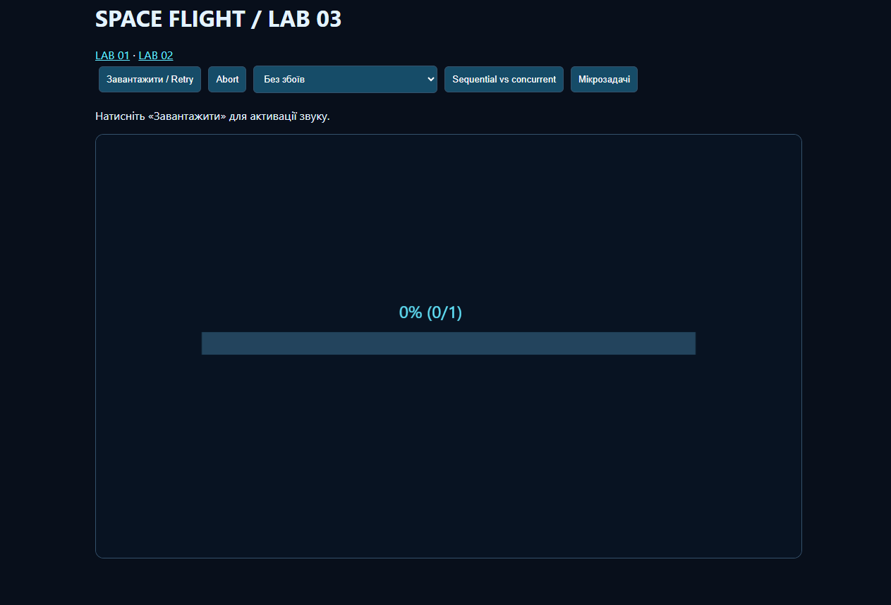

### Завантаження ресурсів та лобі


### Ігровий процес


### Помилка завантаження спрайта


### Таймаут мережі


### Скасування завантаження


### Битий JSON


### Sequential vs concurrent
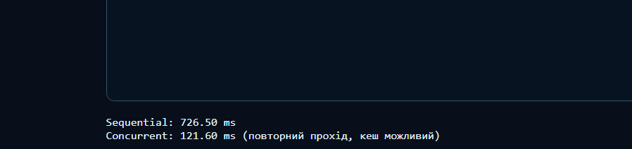

### Порядок мікрозадач


### Успішна збірка проєкту


# Лабораторна 4 — WebSocket та Node.js Streams

## Мета
Дослідити двосторонній обмін даними через WebSocket, керування кімнатами, потокове логування та передачу великих файлів у Node.js.

## Запуск
```bash
npm install
PORT=3002 npm run server
```
В іншому терміналі:
```bash
npm run dev -- --host 0.0.0.0
```
Відкрити /lab04.html на порту клієнта; якщо клієнт потребує налаштування адреси сервера, використати порт 3002. Ввести ім’я та кімнату, натиснути Join. Для перевірки чату відкрити другу вкладку з іншим ім’ям.

## Реалізація
- WebSocket Lobby: кімнати, список гравців, події join, chat, leave.
- Heartbeat ping/pong кожні 15 с, таймаут входу 5 с.
- Обмеження 10 повідомлень за секунду, payload 4096 байтів, поріг bufferedAmount 65536 байтів.
- Перевірка JSON та типів повідомлень.
- Конфігурація PORT і LOG_DIR через змінні середовища.
- NDJSON: PassThrough → Transform → файловий потік; кожна подія записується окремим JSON-рядком із часовою міткою. Backpressure обробляється через очікування drain.
- Replay API: GET /api/replay/:matchId повертає журнал потоково.

## Фактичні результати
- GET /health на порту 3002: HTTP 200, status ok.
- WebSocket: підтверджено join, chat, leave; нормальне закриття 1000.
- У журналі NDJSON зафіксовано всі три події.
- Replay існуючого журналу: HTTP 200, application/x-ndjson.
- Replay відсутнього журналу: HTTP 404.
- Передача тестового файлу 96 688 890 байтів (200 000 записів): HTTP 200.

## Експеримент RSS
| Показник | Значення |
|---|---:|
| Кількість вимірювань | 45 |
| Мінімальний RSS | 80.57 MiB |
| Максимальний RSS | 89.30 MiB |
| Середній RSS | 84.50 MiB |
| Розмах RSS | 8.73 MiB |

Швидкість завантаження обмежено до 2 MiB/s командою curl. За час експерименту RSS змінювався значно менше, ніж розмір переданого файлу. Один експеримент не доводить відсутності витоків пам’яті.


[Дані вимірювань CSV](docs/lab04/rss.csv) · [Документація LAB 04](docs/lab04/README.md)

## Перевірка
```bash
npm run build
npm test
```
Збірка та команда тестування завершилися успішно (LAB 04 CHECK OK). На сервері Node.js test runner виявив 0 тестів, тому це не є підтвердженням проходження автоматичних серверних тестів. Функціональність перевірено вручну через браузер, WebSocket-клієнт та curl.

## Висновок
Реалізовано обмін повідомленнями в реальному часі, керування кімнатами, логування NDJSON і потокову видачу журналів. Експеримент RSS показав обмежене зростання використання пам’яті під час передачі великого файлу.

## Галерея результатів LAB 04

### 1. Початковий інтерфейс

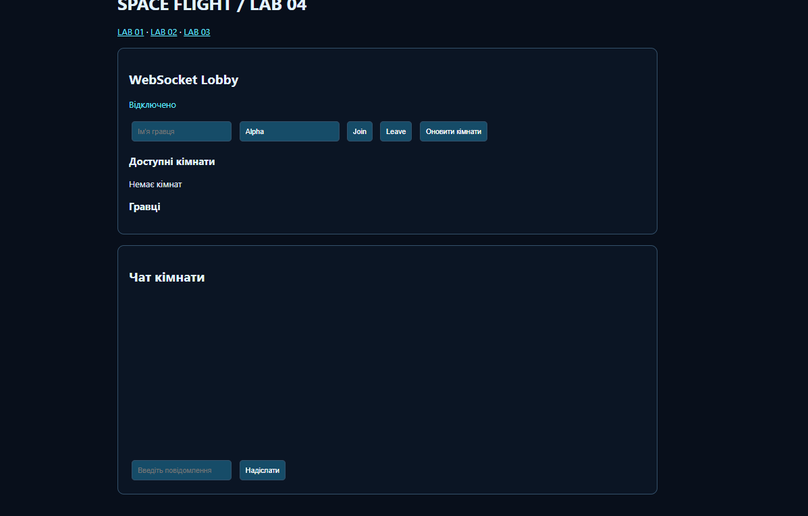

### 2. Два гравці в кімнаті

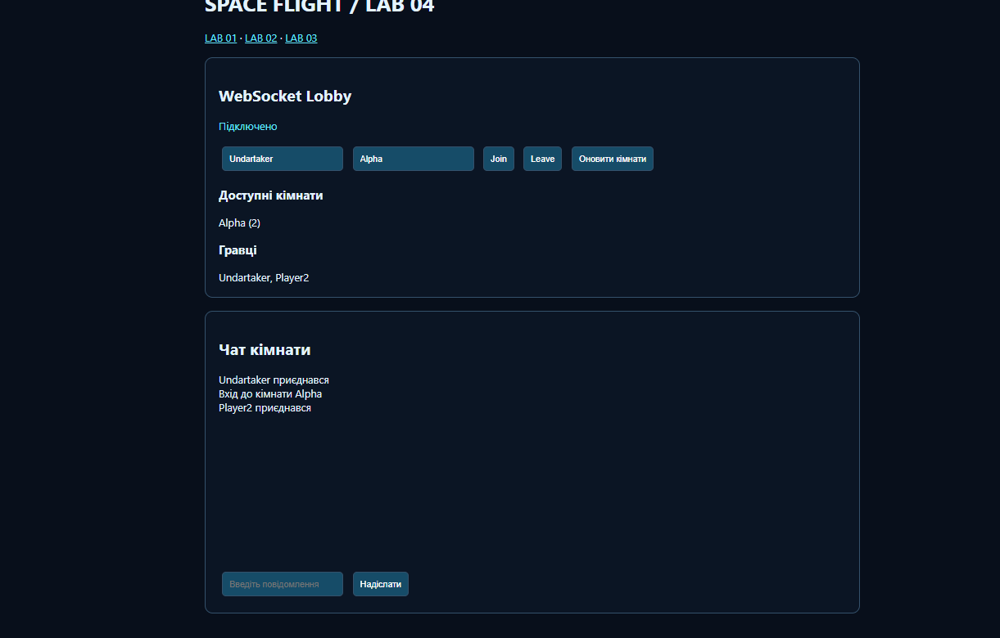

### 3. Обмін повідомленнями

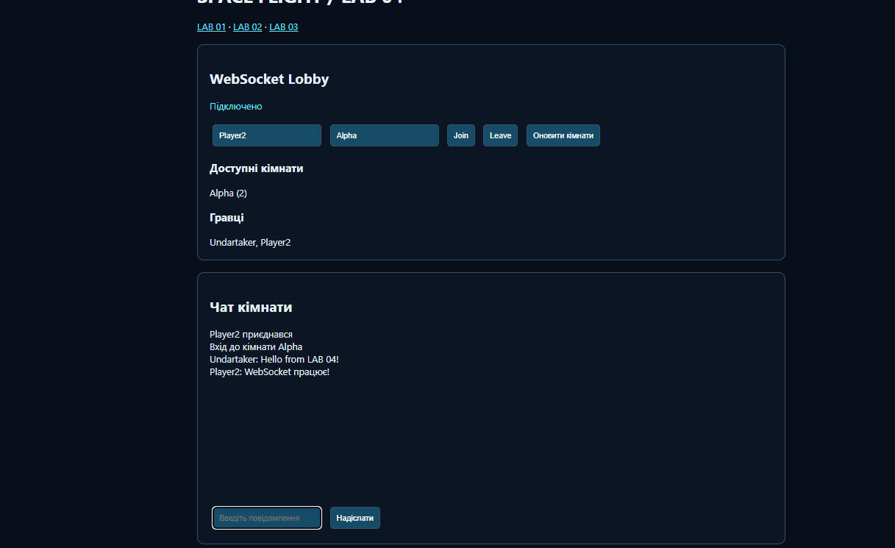

### 4. Вихід гравця

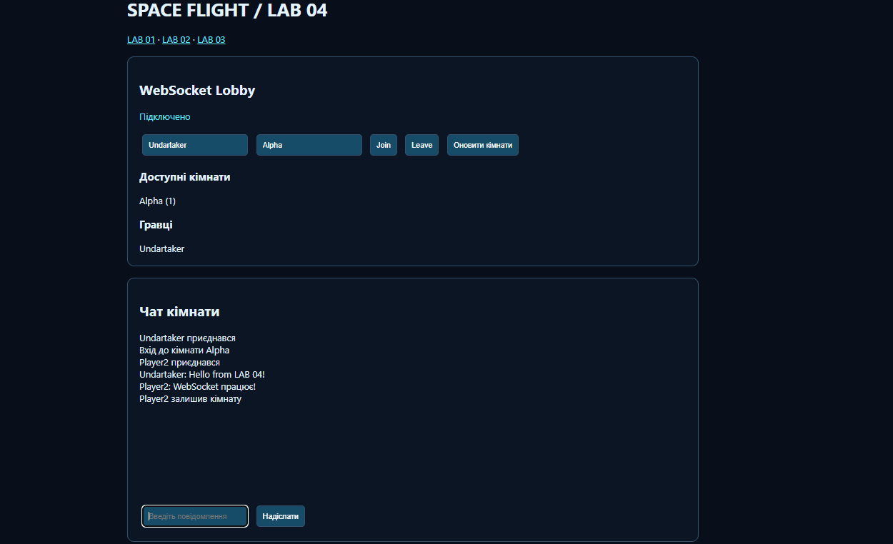

### 5. Відключення клієнтів

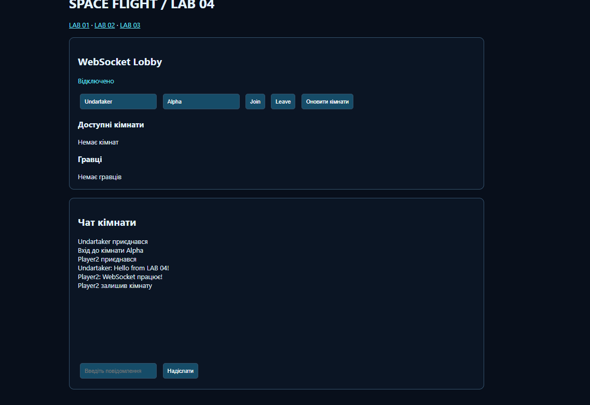

### 6. Перевірка HTTP /health

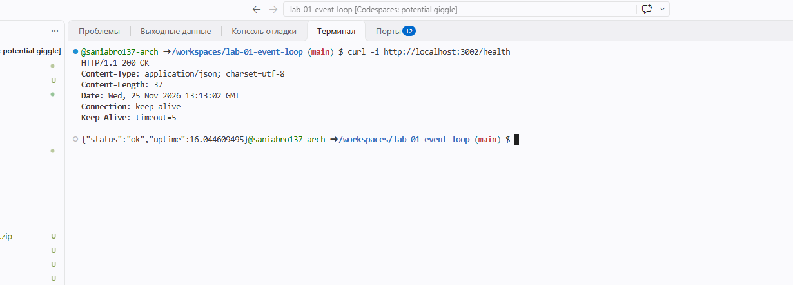

### 7. Логування NDJSON

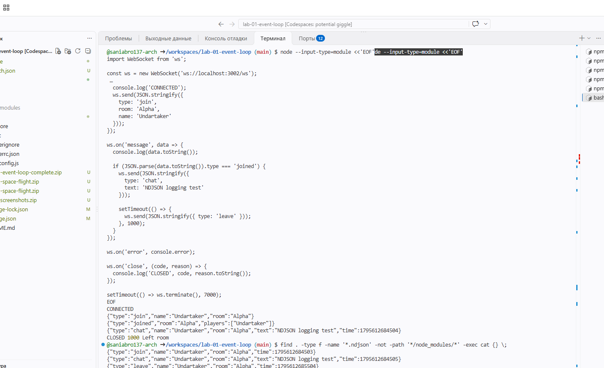

### 8. Replay API

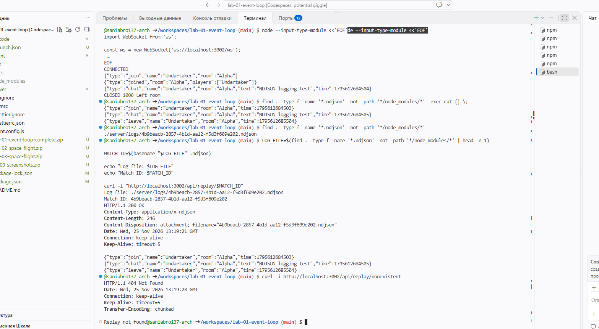

### 9. Потокова передача великого файлу

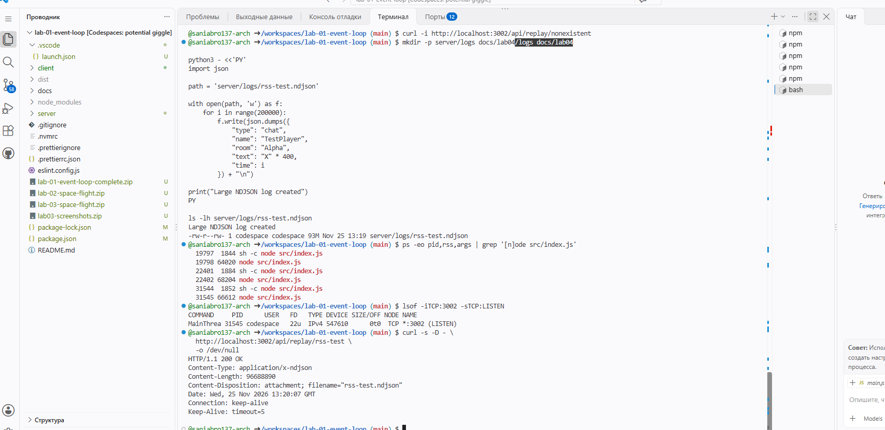

### 10. Вимірювання RSS

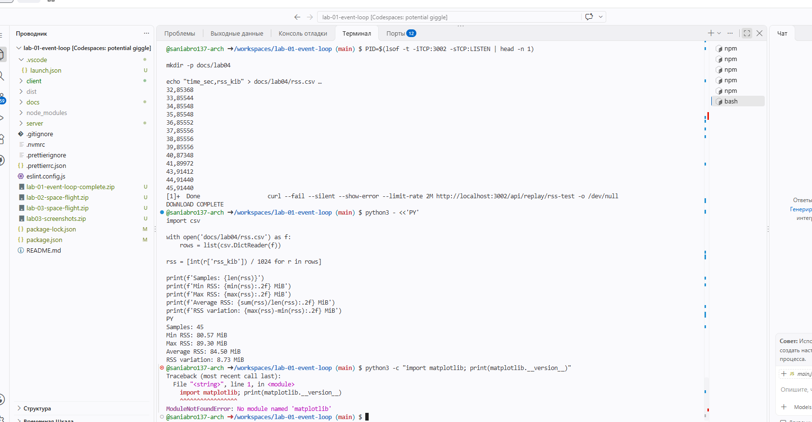

### 11. Збірка та тестування

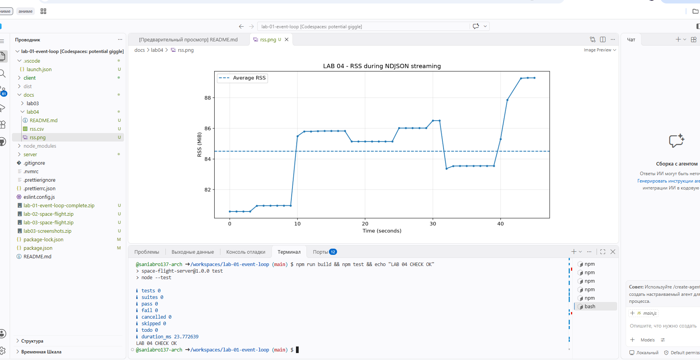

---

<!-- lab05-start -->
# Лабораторна робота №5 — мережева симуляція Space Flight

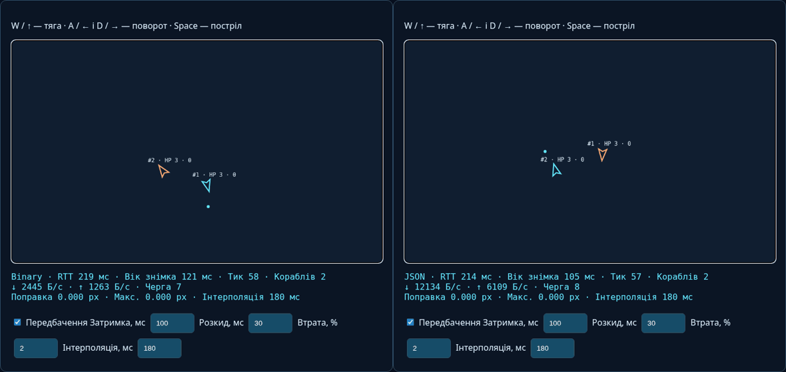

## Запуск

    npm ci
    npm run build
    PORT=3005 npm run server

Відкрий `/lab05.html` і `/lab05.html?codec=json` у двох вікнах.
Введи різні імена й зайди в одну кімнату.
W або ↑ — тяга, A/D або ←/→ — поворот, Space — постріл.

## JSON і Binary

Заміри виконано на одному знімку чотирьох кораблів із дев’ятьма активними кулями і пакеті з вісьмома
командами. Швидкість розраховано для 30 пакетів за секунду без заголовків
WebSocket. Час — середнє за 30 000 циклів кодування та декодування знімка.

| Формат | Байтів/знімок | КБ/с вниз | КБ/с вгору | Кодування + декодування, мкс |
|---|---:|---:|---:|---:|
| JSON | 1901 | 57.03 | 6.57 | 18.98 |
| Binary | 335 | 10.05 | 1.29 | 9.60 |

Замір повторюється командою `node docs/lab05/measure.mjs`.
Бінарний формат використовує `DataView`, порядок байтів little-endian
і кут `Int16` з кроком 0,001 радіана.

## Як працює мережа

**Серверна симуляція.** Клієнт надсилає номер команди та дії гравця.
Сервер обчислює рух, постріли й влучання на 30 Гц. Підміна координат
у браузері впливає лише на локальне зображення.

**Передбачення і звірка.** Клієнт одразу застосовує свою команду.
Після знімка він бере серверний стан і повторно програє команди з номерами
понад `lastProcessedSeq`. Візуальна поправка згасає приблизно за 100 мс.
Netgraph показує RTT, вік знімка, трафік, чергу та поправку.

**Інтерполяція.** Чужі кораблі й кулі відображаються між двома знімками.
Для демонстрації використовуємо буфер 180 мс за затримки 100 мс у кожен бік,
розкиду ±30 мс і втрати 2%. Буфер згладжує нерівномірну доставку, додаючи
затримку до відображення чужого корабля.

## Перевірка в браузері

Два клієнти приєдналися до однієї кімнати, обмінялися повідомленням у чаті
та отримували знімки у форматах Binary і JSON. За штучної затримки
100 мс у кожен бік, розкиду ±30 мс і втрати 2% у режимі без передбачення
один знімок netgraph показав RTT 219 мс, вік знімка 121 мс і чергу
з 7 непідтверджених команд. У режимі з передбаченням мережевий RTT
зберігається, а свій корабель реагує на локальному кроці.

Для перевірки розбіжності ввімкнули передбачення, встановили 100 мс
затримки без розкиду і втрат та повторили маневр W + D. Браузерна
версія інтегратора в експерименті тимчасово додавала
`(Math.random() - 0.5) * 12` до X кожного кроку. Сервер залишався
на детермінованій версії.

| Прогін | Поточна поправка, px | Максимальна поправка, px |
|---|---:|---:|
| Детермінований інтегратор | 0,003 | 0,006 |
| Випадковий зсув у браузері | 5,623 | 41,903 |

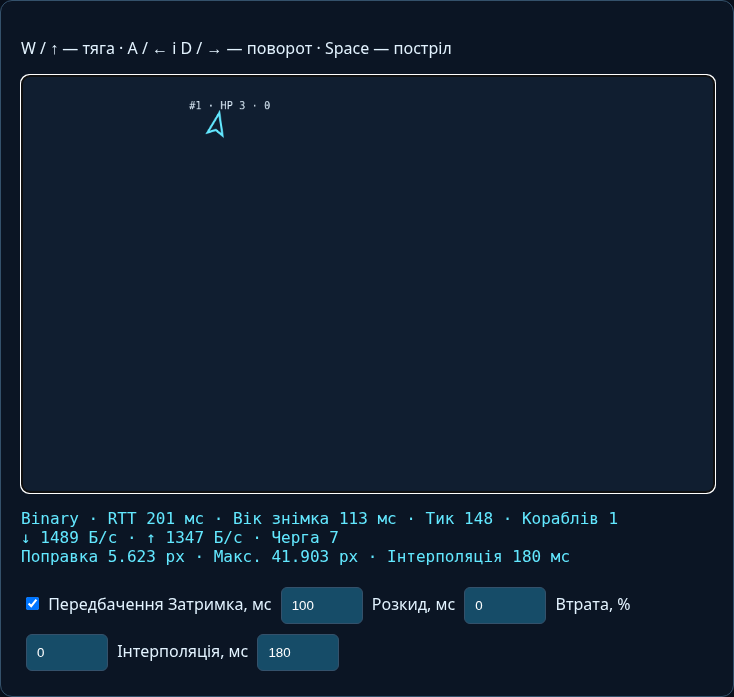

<!-- lab05-end -->

---

# Лабораторна 6 — TypeScript для протоколу і симуляції

Код клієнта, сервера та спільної симуляції переведено на TypeScript.
Конфігурація використовує strict, noUncheckedIndexedAccess і
verbatimModuleSyntax. Схеми Zod перевіряють мережевий JSON і конфігурацію
сервера під час виконання. Бінарний декодер через DataView перевіряє
версію, довжину й допустимі значення полів.

## Що виявив TypeScript

Пошук у Map і доступ до елемента масиву можуть повернути undefined.
Також отримання DOM-елемента чи Canvas-контексту може повернути null.
Додано перевірки перед використанням цих значень. Для обробників
повідомлень і сутностей використано вичерпний switch із never.

## Три типи простими словами

- EntityId — номер сутності в ігровому світі.
- Tick — номер кроку серверної симуляції.
- Seq — порядковий номер команди гравця.

Кожен із цих типів зберігається як число. Брендування дозволяє
компілятору виявити підміну одного номера іншим.

## Перевірка та інтерфейс

Тест зіставляє стан світу з тегом lab-05 після кожного з 1000 кроків.
Окремий тест перевіряє JSON і бінарні пакети. GitHub Actions запускає
npm run typecheck, npm test і npm run build на Node.js 24.

Інтерфейс залишено на DOM і Canvas. Для лобі й HUD достатньо наявних
обробників подій, а цикл симуляції працює незалежно від UI-фреймворків.

---

# Лабораторна 7 — Продуктивність і тестування

[](https://github.com/saniabro137-arch/lab-01-event-loop/actions/workflows/typecheck.yml)

## Тести

66 тестів Vitest, зокрема 6 властивостей fast-check. Fake timers перевіряють
ігровий цикл і heartbeat. Окремі тести перевіряють звірку стану, протокол
і команди ботів. Покриття shared — 98,92% рядків і 92,06% гілок.
Playwright підтвердив між клієнтами Binary і JSON рух корабля та доставку чату.
CI запускає typecheck, типізований ESLint, тести, збірку й Playwright.

## Профілювання

| Показник | До | Після |
|---|---:|---:|
| p99 серверного кроку після зміни черги, мс | 2,336 | 2,617 |
| p99 роботи callback після кешування індексу, мс | 2,5 | 2,7 |
| p99 інтервалу між кадрами під трасуванням, мс | 33,2 | 16,8 |
| Маркери MajorGC у потоці гри | 0 | 0 |

Сервер перебирає чергу без тимчасового масиву ключів і зберігає порядок seq.
Браузер кешує індекс сутностей для кожного знімка. Ці прогони не підтвердили
виграшу за p99 серверного кроку або роботи callback. Зменшення інтервалу
між кадрами зафіксовано в одній парі трас. Ціль менше ніж 16,7 мс
за інтервалом не підтверджено. Просторовий індекс і пул об’єктів не додавали,
оскільки заміри не показали необхідності в цих змінах.

[Таблиця базових замірів](docs/lab07/comparison.md) ·
[Розбір CPU-профілів](docs/lab07/profile-before.txt)

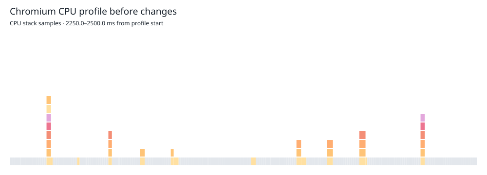
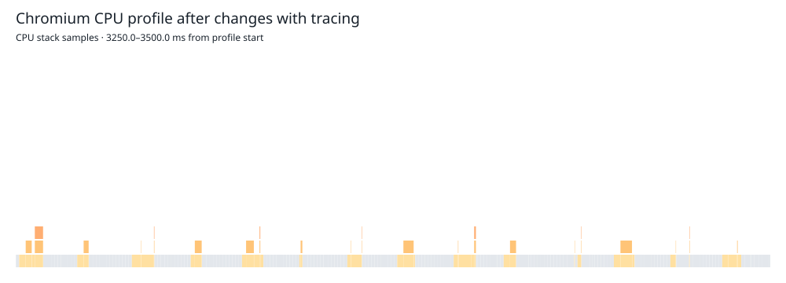

## Боти і Web Worker

Два боти на матч отримували серверні знімки й надсилали стандартні команди.
Локальний сервер витримав усі перевірені рівні до 16 матчів із 32 ботами.
На цьому рівні p99 кроку — 0,119 мс, p99 відхилення від розкладу — 2,223 мс,
а найнижча частота отримання знімків — 29,96/с серед клієнтів.
Рівні понад 16 матчів не вимірювали.

Для 32 рішень прямий розрахунок був нижче роздільності таймера,
а Worker відповів за 0,2 мс за p95. Для 32 768 рішень p95 становив
6,8 мс напряму і 8,2 мс через Worker. Поточний розрахунок залишили
в головному потоці.

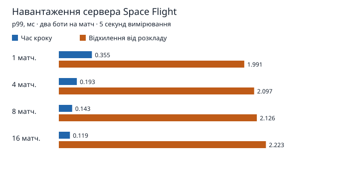

[Сирі дані навантаження](docs/lab07/load-results.json) ·
[Замір Web Worker](docs/lab07/worker-results.json)
