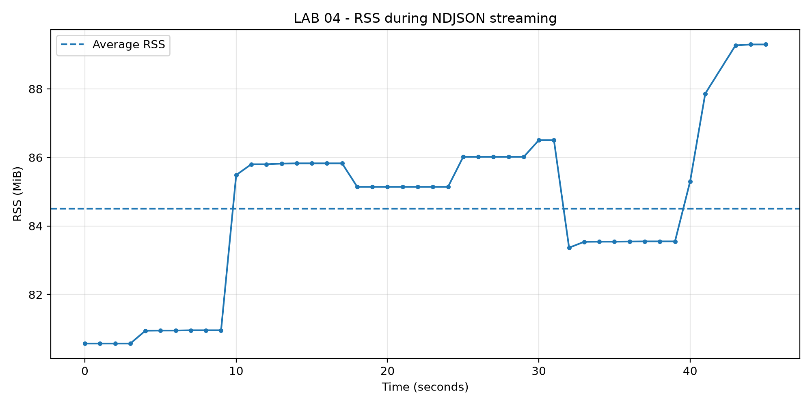

# LAB 04 — WebSocket та Node.js Streams

## Реалізований функціонал

- WebSocket Lobby
- Створення ігрових кімнат
- Підключення та відключення гравців
- Обмін повідомленнями в реальному часі
- Heartbeat ping/pong
- Rate limiting
- Перевірка JSON-повідомлень
- Логування подій у форматі NDJSON
- Replay API
- Потокова передача файлів
- Вимірювання використання пам'яті RSS

## Результати експерименту

- Кількість записів: 200000
- Кількість вимірювань: 45
- Мінімальний RSS: 80.57 MiB
- Максимальний RSS: 89.30 MiB
- Середній RSS: 84.50 MiB
- Коливання RSS: 8.73 MiB

## Графік RSS

## Перевірка

npm run build
npm test
