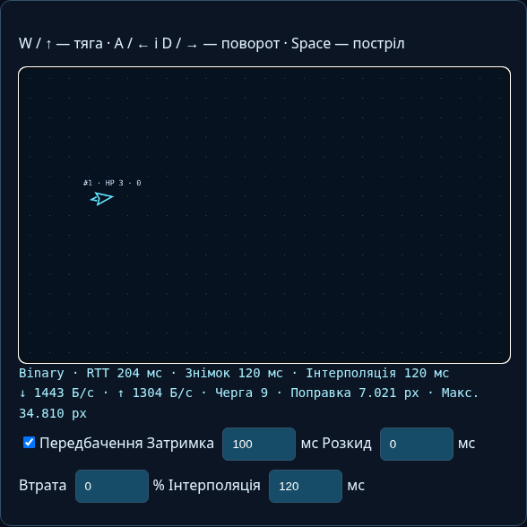

# Лабораторна робота №5. Мережева симуляція

## Затримка і передбачення

Клієнт надсилає натиснуті кнопки із порядковим номером `seq`. В одній кімнаті сервер виконує 30 кроків симуляції за секунду. Наступний виклик `setTimeout` планується за цільовим часом, якому додається рівно 1000/30 мс. Такий розклад компенсує короткі затримки циклу подій. У кінці демонстрації `/api/stats` показав на тику 679 тривалість кроку 0,126 мс і запізнення відносно цілі 0,988 мс. Це одна вибірка.

Імітатор додавав 100 мс в кожному напрямку, рівномірний розкид ±30 мс і 2% незалежних втрат повідомлень на стороні браузера. У режимі без передбачення бінарний клієнт показав RTT 206 мс, вік знімка 122 мс і 9 непідтверджених команд. Ефект клавіші з’являвся після шляху клієнт → сервер → клієнт з урахуванням серверної черги. Після ввімкнення передбачення бінарний клієнт показав RTT 224 мс, вік знімка 100 мс та 8 непідтверджених команд. Реакція свого корабля й пострілу залежать від локального кроку, а RTT вимірює той самий мережевий шлях в обох режимах.

## Звірка і розбіжність

Знімок містить `tick` і персональний `lastProcessedSeq`. Наприклад, якщо сервер підтвердив 57, а в клієнта залишилися команди 55–61, клієнт встановлює серверний стан, відкидає 55–57 і програє 58–61. Відстань між прогнозом до і після звірки стає показником поправки. Візуальний зсув згасає приблизно за 100 мс. Кулі зіставляються за парою власник і номер пострілу. Після підтвердження клієнт бере рішення про існування кулі зі знімка.

Для перевірки в браузері тимчасово підмінив `integrate`, додавши до координати X вираз `(Math.random() - 0.5) * 12` на кожному кроці. За 100 мс в кожному напрямку без розкиду й втрат контрольний прогін показав поправку 0,007 px з максимумом 0,007 px. Із випадковим зсувом поточна поправка становила 7,021 px, максимальна — 34,810 px. Після експерименту спільний інтегратор знову використовує детерміноване обчислення. На однаковій послідовності з 1000 кроків у Node і Chromium отримано хеш `9fbf9747`. Перед хешуванням дробові компоненти округлено до семи десяткових знаків.

## Інтерполяція

Чужі кораблі та кулі малюються за двома знімками навколо моменту `оцінений час сервера − затримка інтерполяції`. Поява і зникнення відображаються на межі відповідного знімка. За браку наступного знімка клієнт тримає останній відомий стан. Для демонстрації обрано 180 мс. Після доставки за 100–130 мс цей буфер дає 50–80 мс запасу, приблизно 1,5–2,4 інтервали знімків. Запас частково покриває розкид доставки та втрати знімків. Більше значення робить рух плавнішим і збільшує вік позиції суперника. Для звичайної мережі початкове значення — 120 мс, його можна змінити на сторінці. Влучання розраховуються на сервері за актуальним станом, тому за великої затримки цілитися складніше.

## Довіра до клієнта

Зміна координат у локальній пам’яті змінює зображення в одного гравця. Сервер отримує тільки порядковий номер і бітову маску дій. Він обмежує розмір пакета, перевіряє версію бінарного формату, допустимі кнопки й послідовність номерів. На одного гравця виконується до однієї команди за серверний крок. Сервер визначає швидкість, частоту пострілів, влучання, HP, респаун і рахунок. Пакет може містити до восьми останніх непідтверджених команд. Повтори допомагають при штучній втраті, а сервер ігнорує дублікати.
